# ACADEMIC GUIDE CONVERSATION RECORD & MASTER SPECIFICATION
**Project**: Gann Celestial Tracker Pro • Institutional Astro-Harmonic Terminal  
**Document Purpose**: Complete, consolidated single-copy record of the full architectural dialogue, decisions, pedagogical models, and chapter-by-chapter curriculum specification for peer review by Gemini or any quantitative reviewer.  
**Implementation Constraint**: Conceptual review document only. Absolutely no code modification until all preliminary tasks are completed and explicit user authorization is granted.

---

## 1. Executive Overview & Core Philosophy

This record synthesizes the complete 29-step interactive alignment dialogue regarding the **Educational Academy & Research Guide** embedded in the Gann Celestial Tracker Pro desktop terminal.

### The Pedagogical Mandate: "Teach Like to a 1st-Standard Student"
1. **Zero Jargon First**: Complex mathematical and astronomical phenomena (ecliptic longitudes, synodic periods, polynomial interpolation, Square of Nine spiral roots) must never be introduced with raw Greek symbols or intimidating equations first.
2. **Everyday Physical Analogies**: Ground every concept in tangible, everyday reality that a child or complete beginner encounters (wall clocks, sun shadows, castle rooms, seesaws, speedometers, musical strings).
3. **Progressive 3-Tier Ascendance**:
   - **Tier 1: Beginner (Chapters 1–6)**: Intuitive physical mental models & capital preservation.
   - **Tier 2: Intermediate (Chapters 7–12)**: Quantitative formulas, exact Indian market calculations across 5 benchmark asset scales, and daily trading routines.
   - **Tier 3: Advanced & Master (Chapters 13–16)**: Macro heliocentric secular clocks, geometric angle velocity rails, standing-wave octave physics, and Triple Confluence execution.
4. **Authoritative Format**: A clean, serious reference manual with an interactive Table of Contents for instant quick-jump navigation.

---

## 2. Chronological Dialogue & Decision Log (Questions 1 to 29)

| Question # | Topic Explored | User Decision / Instruction | Underlying Pedagogical & Trading Principle |
| :---: | :--- | :--- | :--- |
| **Q1** | Primary target audience | **A Beginner** | Assumes zero prior knowledge of astronomy or Gann theory; requires intuitive entry points. |
| **Q2** | Teaching method for beginner | **Best method for 1st-standard student** | Selected natural visual analogies before introducing any numerical formulas. |
| **Q3** | Initial starting concept | **"The Clock in the Sky"** | Everyone understands a wall clock with rotating hands; nature moves in repeating circular cycles. |
| **Q4** | Clock hands focus | **Equal picture of both Fast and Slow hands** | Fast second-hand Moon (intraday swings) nested within slow hour-hand Saturn/Jupiter (macro trends). |
| **Q5** | Geocentric vs. Heliocentric | **All three in order of hierarchy** | 1. Sun View (True orbital physics) $\rightarrow$ 2. Earth View (Perception & emotion) $\rightarrow$ 3. Unified Teamwork (Weather vs. Umbrella). |
| **Q6** | Price-to-Degree analogy | **Option 1: The Sun & Your Shadow** | The Sun's angle in the sky strictly dictates shadow length on the ground; planetary angle dictates market price length. |
| **Q7** | 12:22 PM Session Midpoint | **Option A: The Lunchtime Bell** | Just like school recess marks the shift from morning classes to afternoon games, 12:22 PM marks the natural daily shift. |
| **Q8** | Action on Chime / Alert | **Approach 3: The 3-Step Rule** | Step 1: Notice Time $\rightarrow$ Step 2: Check Gann Price Level $\rightarrow$ Step 3: Wait 3 minutes for confirming candle. |
| **Q9** | 360° Wheel visualization | **The 12-Room Round Castle** | A circular castle with 12 rooms ($30^\circ$ each); planets are visitors walking from room to room. |
| **Q10** | Aspect lines sequence | **First $90^\circ$, then $180^\circ$, then $30^\circ$** | 1. $90^\circ$ Square (Sharp corner bounce) $\rightarrow$ 2. $180^\circ$ Opposition (Across the hallway / tug-of-war) $\rightarrow$ 3. $30^\circ$ Ingress (Next room step). |
| **Q11** | Planetary rulerships | **Option A: Character / Element Analogy** | Mars = Fire, heat, oil barrels, smelting metals (MCX Crude & Base Metals); Moon = Ocean tides, quick mood swings (Nifty 50). |
| **Q12** | Bullion exclusion reason | **Capital Defense for Small Traders** | Gold & Silver are high-value instruments for big institutions; small traders get wiped out in minor corrections. We stay away to protect capital. |
| **Q13** | Beginner 6-Chapter Flow | **Approved (Chapters 1 to 6)** | Established the complete Beginner Curriculum. |
| **Q14** | Intermediate opening topic | **Option A: The Two Crosses (Cardinal vs. Fixed)** | Immediately provides concrete support and resistance price numbers on the chart. |
| **Q15** | Cardinal vs. Fixed Cross rules | **Rule Set 1: Hard Walls vs. Soft Fences** | Cardinal ($90^\circ$) = Heavy brick wall (major reversals/breakouts); Fixed ($45^\circ$) = Wooden fence (minor pauses/consolidation). |
| **Q16** | Planetary Stations & Retrograde | **Strategy C: 2-Phase Protocol** | Phase 1 (Station $v \approx 0$): Tighten trailing stops, prepare for chop; Phase 2 (Directional Flip): Enter with confirmed reversal trend. |
| **Q17** | Square of Nine calculation examples | **Option C + All 5 Benchmarks** | Walkthrough across 5 asset tiers: Sensex (~80k), Nifty (~24.5k), Crude Oil (~6k), Copper (~820), Natural Gas (~240). |
| **Q18** | Solar Noon seasonal drift | **Option A: Pure Astronomical Logic** | Earth's elliptical orbit and $23.5^\circ$ axial tilt explain why True Solar Noon shifts between 12:12 and 12:44 PM IST via Spencer EoT. |
| **Q19** | Topocentric vs. Geocentric Moon | **Both Rules Integrated** | Topocentric (Mumbai) is default for active Indian intraday sessions; Geocentric is for historical global textbook verification. |
| **Q20** | Intermediate daily routine | **Approved 4-Step Professional Workflow** | Pre-Market 09:00 AM $\rightarrow$ Session 09:15-15:30 $\rightarrow$ Trade Management $\rightarrow$ Post-Market 15:35 PDF Export. |
| **Q21** | Next curriculum phase | **Advance & Master Level** | Proceeded into high-level institutional and mathematical mechanics. |
| **Q22** | Master Level opening topic | **Option B: $1\times 1$ Geometric Angle Rail** | Explores pure physical price-time velocity balance. |
| **Q23** | $1\times 1$ Angle explanation | **Method 2: The Speedometer Analogy** | $1\times 1$ is a fixed cruise control gauge ($1\text{ pt}/1\text{ min}$), not an unscaled drawing; immune to screen zooming. |
| **Q24** | Master Time Factor cycles | **Perspective 3: The Nested Russian Doll** | 20-year Jupiter-Saturn secular cycle acts as the big clock; 2.21-year Mars-Jupiter cycle acts as the internal swing gear. |
| **Q25** | Musical Octave vibration | **Explanation C: Dual Resonance** | Human crowd psychology fuels the emotion, but physical standing-wave mechanics dictates the exact $1/8\text{th}$ octave price nodes. |
| **Q26** | Triple Confluence execution | **Execution Strategy 3: Complete Master Rulebook** | Sniper precision (tight 15-20 pt stop beyond Gann line for 100-300 pt reaction) + progressive risk allocation ($1\times, 2\times, \text{full}$). |
| **Q27** | Terminal UI presentation | **Option C: Interactive Table of Contents** | Quick-jump index allowing users to click directly to any of the 16 chapters. |
| **Q28** | Self-test quizzes vs. Reference | **Option B: Pure Reference Manual** | Clean, uninterrupted textbook and trading journal format without quiz cards. |
| **Q29** | Final Task Staging Sequence | **Execute preparatory tasks first** | Task 1: Complete conversation compilation $\rightarrow$ Task 2 $\rightarrow$ Task 3 $\rightarrow$ Explicit permission before coding. |

---

## 3. The Complete 16-Chapter Curriculum Blueprint

```mermaid
flowchart TD
    subgraph Level1 ["TIER 1: THE BEGINNER MANUAL (Chapters 1–6)"]
        C1["Ch 1: The Clock in the Sky\n(Fast Moon vs. Slow Saturn)"]
        C2["Ch 2: Where Are You Looking From?\n(Sun View -> Earth View -> Teamwork)"]
        C3["Ch 3: The Sun and Your Shadow\n(Sky Angle = Ground Price Length)"]
        C4["Ch 4: The 12-Room Round Castle\n(90° Corner, 180° Hallway, 30° Room)"]
        C5["Ch 5: The Daily Indian Market Rhythm\n(12:22 Lunch Bell & 3-Step Confirmation)"]
        C6["Ch 6: Capital Defense & Instruments\n(Mars Rulership; Bullion Exclusion)"]
        C1 --> C2 --> C3 --> C4 --> C5 --> C6
    end

    subgraph Level2 ["TIER 2: THE INTERMEDIATE QUANT (Chapters 7–12)"]
        C7["Ch 7: The Two Crosses\n(Cardinal Brick Wall vs. Fixed Fence)"]
        C8["Ch 8: Planetary Stations & Retrogrades\n(The 2-Phase Braking Protocol)"]
        C9["Ch 9: Square of Nine Scale Invariance\n(Sensex, Nifty, Crude, Copper, Gas)"]
        C10["Ch 10: Solar Noon Seasonal Drift\n(Spencer EoT, Elliptical Orbit & 23.5° Tilt)"]
        C11["Ch 11: Topocentric Mumbai Parallax\n(0.80° Surface Shift vs. Geocenter)"]
        C12["Ch 12: Professional Daily Workflow\n(09:00 Pre -> 09:15 Live -> 15:35 PDF)"]
        C6 --> C7 --> C8 --> C9 --> C10 --> C11 --> C12
    end

    subgraph Level3 ["TIER 3: THE MASTER HARMONICS (Chapters 13–16)"]
        C13["Ch 13: The 1x1 Geometric Speedometer\n(Fixed Velocity vs. Screen Zoom Trap)"]
        C14["Ch 14: The Master Time Factor\n(Nested 20-Yr & 2.2-Yr Heliocentric Gears)"]
        C15["Ch 15: Pythagorean Octaves of Vibration\n(Standing Wave Nodes: 1/8 to 8/8)"]
        C16["Ch 16: The Triple Confluence Cluster Node\n(Sniper Precision & Progressive Sizing)"]
        C12 --> C13 --> C14 --> C15 --> C16
    end
```

---

## 4. Comprehensive Chapter-by-Chapter Content Specifications

### TIER 1: THE BEGINNER MANUAL (Foundations & Capital Defense)

#### Chapter 1: The Clock in the Sky (Fast vs. Slow Hands)
* **Core Analogy**: A standard 3-hand wall clock.
* **The Hands**:
  - *The Second Hand (The Moon)*: Moves ultra-fast (~$13.2^\circ/\text{day}$, ~$0.55^\circ/\text{hour}$). Drives intraday volatility and $\pm 15$-minute reaction windows during the NSE 09:15–15:30 session.
  - *The Minute Hand (Sun, Mercury, Venus)*: Completes the dial in 1 year. Dictates monthly expansions and seasonal shifts.
  - *The Hour Hand (Jupiter, Saturn)*: Takes 12 to 30 years to circle the dial. Controls long-term secular market eras and generational wealth cycles.
* **Key Beginner Takeaway**: You never judge the hour by looking only at the second hand, and you never time an intraday trade using only the hour hand. They work as one synchronized time machine.

#### Chapter 2: Where Are You Looking From? (The 3-Tier Hierarchy)
* **Core Analogy**: The Playground Carousel.
* **Level 1 (The Sun View / Heliocentric)**: The master view from the center booth. All planets orbit smoothly forward in pure continuous direct cycles. This represents the *Master Climate*.
* **Level 2 (The Earth View / Geocentric)**: The view from a horse on the carousel. Because Earth is also moving, other runners appear to slow down, stop, and temporarily move backward (Retrograde). This represents *Daily Human Emotion & Perception*.
* **Level 3 (The Unified Teamwork)**: Heliocentric tells you if it is winter or summer; Geocentric tells you the exact hour it will rain today so you know when to open your umbrella.

#### Chapter 3: The Sun and Your Shadow (How Sky Angles Dictate Price Lengths)
* **Core Analogy**: The Morning-to-Evening Shadow of a Child.
* **Physical Principle**: At sunrise, the Sun is on the horizon ($0^\circ$), casting a long shadow on the ground. At noon ($90^\circ$ overhead), the shadow shrinks to zero length. At sunset ($180^\circ$ opposite horizon), the shadow stretches in the opposite direction.
* **Market Translation**: The planet in the sky is the Sun; the market price on your chart is the shadow. When a planet reaches a geometric angle, it directly forces the market price to a mathematically corresponding length.

#### Chapter 4: The 12-Room Round Castle (Reading the 360° Wheel)
* **Core Analogy**: A circular castle partitioned into 12 equal rooms ($30^\circ$ each), with a central open courtyard.
* **The Path of Movement**:
  - **$90^\circ$ Sharp Corner (The Square)**: Two visitors looking at each other around a rigid right-angle wall. High friction, sudden turns. *Market reaction: Expect a sharp bounce or abrupt reversal.*
  - **$180^\circ$ Opposite Hallway (The Opposition)**: Two visitors standing at opposite ends of the castle looking straight through the courtyard. A maximum tug-of-war stretch. *Market reaction: Extreme trend exhaustion and major swing pivot.*
  - **$30^\circ$ Next Room Step (The Ingress)**: A visitor packing their bags and walking through the door into the next room. *Market reaction: A fresh shift in market personality and sector rotation.*

#### Chapter 5: The Daily Indian Market Rhythm & The 3-Step Rule
* **Core Analogy**: The School Lunchtime Bell (12:22 PM IST).
* **The Rhythm**: The NSE session runs 375 minutes (09:15 to 15:30). The 50% temporal midpoint occurs at 12:22:30 PM IST, which aligns with True Solar Noon at the Mumbai exchange meridian. The morning climb exhausts here; the afternoon resolution begins.
* **The 3-Step Beginner Rule (Yellow Traffic Light)**:
  1. *Step 1 (Notice Time)*: Hear the chime or see the clock reach a node (e.g., 12:22 PM). Do not rush.
  2. *Step 2 (Check Level)*: Is CMP touching or within a few points of a Gann Price Level?
  3. *Step 3 (Confirm Candle)*: Wait 3 minutes for a confirming candle (hammer, pin-bar, or engulfing) before risking capital.

#### Chapter 6: Capital Defense & Instrument Assignment
* **The Rulerships**:
  - *Mars (The Fire & Engine Planet)*: Rules MCX Energy (Crude Oil, Natural Gas) and MCX Base Metals (Copper, Zinc).
  - *Moon & Mercury (The High-Frequency Oscillators)*: Rules NSE Nifty 50 and BSE Sensex volatility.
* **The Absolute Bullion Exclusion Directive**:
  - *The Reason*: Gold and Silver spot and futures contracts carry extreme tick values and high contract capital requirements designed for sovereign central banks and multi-crore institutional desks. A small retail trader can lose their entire account in a minor 1% gold fluctuation.
  - *The Mandate*: Gold and Silver are permanently blacklisted to defend the trader's capital and enforce focus on high-reliability industrial and index instruments.

---

### TIER 2: THE INTERMEDIATE QUANT (Mechanics, Multi-Asset Math & Routines)

#### Chapter 7: The Two Crosses (Cardinal Brick Walls vs. Fixed Wooden Fences)
* **The Cardinal Cross ($0^\circ, 90^\circ, 180^\circ, 270^\circ$)**:
  - Astronomical anchor: The Equinoxes and Solstices (Aries, Cancer, Libra, Capricorn).
  - Trading Rule: **The Heavy Brick Wall**. Represents primary trend birthplaces, catastrophic breakdown points, or violent trend reversals. Never fight a breakout through a Cardinal level.
* **The Fixed Cross ($45^\circ, 135^\circ, 225^\circ, 315^\circ$)**:
  - Astronomical anchor: The Cross-Quarter midpoints (Taurus, Leo, Scorpio, Aquarius).
  - Trading Rule: **The Wooden Fence**. Represents intermediate consolidation shelves and healthy continuation rest areas. Ideal locations for taking partial profits.

#### Chapter 8: Planetary Stations & Retrogrades (The 2-Phase Braking Protocol)
* **Physical Mechanics**: A planet traveling at orbital velocity must decelerate through $|\dot{\lambda}| \le \text{Threshold}$ before reversing direction.
* **Dynamic Velocity Threshold**: Pluto ($0.00000495^\circ/\text{hr}$), Neptune ($0.00000747^\circ/\text{hr}$), Mars ($0.000654^\circ/\text{hr}$), Moon ($0.01647^\circ/\text{hr}$).
* **The 2-Phase Protocol**:
  - *Phase 1 (The Station / Brake)*: Speed drops near zero. Market chops sideways. **Action**: Tighten trailing stop-losses on winning positions; refuse new breakout trades.
  - *Phase 2 (The Directional Flip)*: Planet turns negative (`RETROGRADE`) or resumes positive (`DIRECT`). **Action**: Enter in the direction of the confirmed new momentum surge.

#### Chapter 9: The Square of Nine Mathematical Scale Invariance
* **The Universal Odd-Square Root Equation**:
  $$\Delta \text{root} = \frac{\theta - \theta_0}{180^\circ}, \quad P_{\text{target}} = \left(\sqrt{P_{\text{base}}} + \Delta\text{root}\right)^2$$
* **5 Benchmark Indian Market Proofs**:
  1. *BSE Sensex (~80,000 pts)*: $\sqrt{80000} \approx 282.84$. A $90^\circ$ square displacement ($+0.5000$) yields $P = (283.34)^2 = 80,283.5\text{ pts}$ ($\Delta = +283.5\text{ pts}$).
  2. *NSE Nifty 50 (~24,500 pts)*: $\sqrt{24500} \approx 156.52$. A $90^\circ$ displacement yields $P = (157.02)^2 = 24,656.7\text{ pts}$ ($\Delta = +156.7\text{ pts}$).
  3. *MCX Crude Oil (~6,000 pts)*: $\sqrt{6000} \approx 77.46$. A $90^\circ$ displacement yields $P = (77.96)^2 = 6,077.7\text{ pts}$ ($\Delta = +77.7\text{ pts}$).
  4. *MCX Copper (~820 pts)*: $\sqrt{820} \approx 28.64$. A $90^\circ$ displacement yields $P = (29.14)^2 = 848.9\text{ pts}$ ($\Delta = +28.9\text{ pts}$).
  5. *MCX Natural Gas (~240 pts)*: $\sqrt{240} \approx 15.49$. A $90^\circ$ displacement yields $P = (15.99)^2 = 255.7\text{ pts}$ ($\Delta = +15.7\text{ pts}$).
* **Key Mathematical Law**: The percentage reaction interval shrinks naturally as price scales upwards, preserving exact harmonic proportionality from ₹240 to 80,000 pts.

#### Chapter 10: Solar Noon Seasonal Drift (Spencer Equation of Time)
* **Astronomical Cause**: Earth's orbit is an ellipse (eccentricity $e = 0.0167$) and its axis is tilted $23.44^\circ$. The Sun travels along the ecliptic, not the celestial equator.
* **Spencer Equation of Time ($\text{EoT}$)**:
  $$\text{EoT} \approx 229.18 \times \left(0.000075 + 0.001868\cos\Gamma - 0.032077\sin\Gamma - 0.014615\cos 2\Gamma - 0.040849\sin 2\Gamma\right)$$
* **Mumbai Geographic Application**: Standard IST is fixed at Mirzapur ($82.5^\circ\text{ E}$). Mumbai sits at $72.8777^\circ\text{ E}$ (a constant $-38.49\text{ minute}$ longitudinal difference).
* **Seasonal Drift Range**: Solar noon at Mumbai swings from **12:12 PM IST in mid-February** to **12:44 PM IST in late October / early November** (currently 12:22:12 IST).

#### Chapter 11: Topocentric vs. Geocentric Moon (Mumbai Parallax Correction)
* **Physical Reality**: The Moon is only ~384,400 km away. An observer on Earth's surface in Mumbai looks at the Moon from a displacement of $6,371\text{ km}$ relative to Earth's center.
* **Measured Parallax Shift**: Exactly **$0.8008^\circ$ ($48.05\text{ arcminutes}$)** on the ecliptic plane.
* **Dual Rule of Engagement**:
  - *Active Intraday Trading*: Always keep `[Topo Moon (Mumbai)]` engaged. This eliminates the 48-arcminute error, pinpointing exact intraday aspects to the minute.
  - *Historical Literature Research*: Switch to `[Geo Moon]` when auditing historical 1930s astro-trading tables, which lacked local topocentric GPS facilities.

#### Chapter 12: Professional Daily Workflow & Checklist
* **09:00 AM (Pre-Market Reconnaissance)**: Open terminal $\rightarrow$ confirm active script $\rightarrow$ verify Topo Moon active $\rightarrow$ record Mumbai Solar Noon time $\rightarrow$ record 50% Daily Equilibrium price line.
* **09:15 AM – 03:30 PM (Session Execution)**: Track 360° Wheel aspect rays $\rightarrow$ listen for chime alerts at key time nodes $\rightarrow$ execute the 3-Step Confirmation Rule (Time $\rightarrow$ Level $\rightarrow$ Candle).
* **In-Session Trade Management**: Set stop-losses behind nearest Gann cross line $\rightarrow$ if planetary velocity drops to `STATIONARY`, activate 2-Phase Braking Protocol.
* **03:35 PM (Post-Market Archival)**: Click **"PDF Summary"** to generate the two-pass ReportLab briefing document for permanent quantitative trade journals.

---

### TIER 3: THE MASTER HARMONICS (Geometry, Multi-Year Gears & Confluence)

#### Chapter 13: True Geometric Angle Rails ($1\times 1$ Speedometer Gauge)
* **The Screen Zoom Fallacy**: Drawing a $45^\circ$ line with an arbitrary ruler on a dynamic monitor fails because resizing changes the pixel aspect ratio.
* **The Speedometer Formulation**:
  $$\text{Geometric Velocity} = \frac{\Delta \text{Price}}{\Delta \text{Time}}$$
* **Velocity Rails**:
  - $1\times 1$ ($1\text{ price unit} / 1\text{ time unit}$): The True Dynamic Cruise Control. When price rides above $1\times 1$, momentum is super-harmonic.
  - $2\times 1$ ($2\text{ price units} / 1\text{ time unit}$): Acceleration surge. Unsustainable over long durations; anticipate sharp pullback to $1\times 1$.
  - $1\times 2$ ($1\text{ price unit} / 2\text{ time units}$): Deceleration crawl. If broken, indicates complete trend capitulation.

#### Chapter 14: The Master Time Factor (Heliocentric Planetary Pairing)
* **The Grand 20-Year Clock (Jupiter-Saturn)**:
  - Synodic Period: Exactly **19.86 years**.
  - Cycle Divisions: $180^\circ$ (10-Year opposition pivot), $90^\circ$ (5-Year cyclical check), $3 \times 19.86 \approx 60\text{ years}$ (Grand Kondratieff / Gann Master Era).
* **The Internal Swing Gear (Mars-Jupiter)**:
  - Synodic Period: Exactly **2.21 years** (~26.5 months).
  - Drives major intermediate cyclical swings in industrial commodities (MCX Crude Oil and Copper) and multi-quarter index trend runs.
* **The Nested Russian Doll Mechanics**: The 20-year clock establishes the macro multi-year liquidity regime; the 2.2-year gear times the multi-month swing legs within it.

#### Chapter 15: The Law of Vibration & The Musical Octave
* **The Pythagorean Principle**: Sound and price are frequency phenomena. Plucking a musical string creates harmonic standing-wave nodes at exact rational fractional lengths.
* **The Musical Eighths Scale ($1/8\text{th}$ to $8/8\text{ths}$)**:
  - $1/8\text{th}$ ($12.5\%$) & $2/8\text{ths}$ ($25\%$): Initial reaction zones.
  - $3/8\text{ths}$ ($37.5\%$): The harmonic minor barrier.
  - $4/8\text{ths}$ ($50\%$): **The Great Center Tone**. The highest-gravity price equilibrium in the universe. If price holds 50%, the entire octave expands upward.
  - $5/8\text{ths}$ ($62.5\%$) & $6/8\text{ths}$ ($75\%$): Secondary rest barriers.
  - $8/8\text{ths}$ ($100\%$): Full Octave Completion. Price doubles or traverses one complete square ring, prompting an immediate trend recalculation.

#### Chapter 16: The Triple Confluence "Cluster Node" (The Master Rulebook)
* **The 3 Locking Crosshairs**:
  1. *Macro Astronomical Aspect*: E.g., Mars squaring Jupiter ($90^\circ$) or Sun opposite Saturn ($180^\circ$).
  2. *Micro Temporal Intraday Clock*: E.g., 12:22:12 IST True Solar Noon or 13:56:15 IST Square Node.
  3. *Gann Geometric Price Line*: E.g., Nifty touching an exact Square of Nine Cardinal Cross line or the 50% Daily Equilibrium level.
* **The Master Execution Rulebook**:
  - **Sniper Precision**: Because time and price are squared, invalidation is immediate. Place an ultra-tight stop-loss (15–20 points on Nifty) just beyond the Gann barrier. Risk-to-reward reaches $1:5$ to $1:10$.
  - **Progressive Risk Sizing Protocol**:
    - *1 Crosshair Active*: Allocate standard base risk ($1\times$).
    - *2 Crosshairs Active*: Allocate double conviction risk ($2\times$).
    - *All 3 Crosshairs Locked (Cluster Node)*: Allocate full institutional risk capacity. This is the rare, high-conviction setup where secular tops and bottoms are forged.

---

## 5. UI Architecture & Reader Navigation Specifications

1. **Interactive Table of Contents (Option C)**:
   - A dedicated sticky navigation panel displaying all 16 chapter headers organized by Level.
   - Clicking any chapter title instantly scrolls the container to that exact anchor position without page reloads.
2. **Pure Reference Manual Architecture (Option B)**:
   - Clean, dignified typography using Segoe UI and Consolas monospace formatting.
   - No pop-up quizzes, juvenile badges, or gamification cards. It remains an authoritative quantitative handbook and institutional trading desk companion.
3. **Persisted State & Access**:
   - The user can open or close the Academy Guide at any time via the top-bar button (`Academy Guide` width 95px).
   - Reading progress and active level state are remembered across restarts in `user_preferences.json`.

---

## 6. Verification & Handover Instructions for Peer Review

When Gemini or another quantitative reviewer inspects this document:
- Cross-verify the Square of Nine mathematical proofs in Chapter 9 against standard odd-square spiral calculations.
- Cross-verify the Spencer Equation of Time values in Chapter 10 against NOAA astronomical algorithms.
- Cross-verify the Topocentric lunar parallax shift in Chapter 11 against NASA JPL Horizons ephemerides.
- Verify that this entire specification adheres strictly to the capital preservation mandate and zero-hallucination directive.

**Status**: Task 1 Complete. Awaiting user instruction for Task 2. Zero code has been modified.
