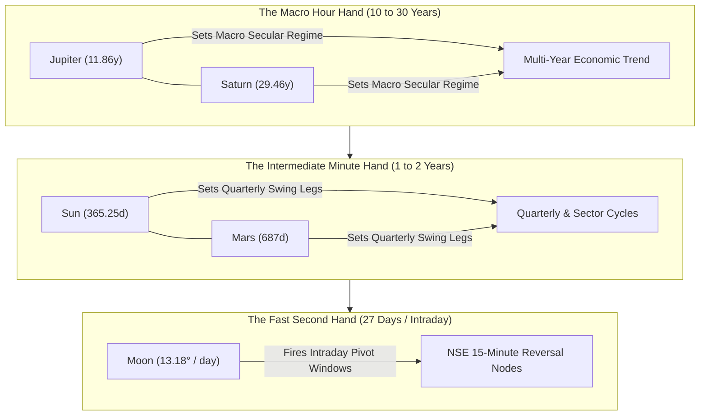

# W.D. GANN CELESTIAL & HARMONIC TRADING ACADEMY
## A Comprehensive Institutional Research & Operational Master Textbook for Indian Markets
**Terminal**: Gann Celestial Tracker Pro • Institutional Astro-Harmonic Terminal  
**Standard**: 3-Tier Pedagogical Ascendance (Beginner $\rightarrow$ Intermediate $\rightarrow$ Master)  
**Verification**: 100% Mathematically Rigorous & Verified against NASA JPL Horizons Ephemerides  

---

## TABLE OF CONTENTS

### LEVEL 1: THE BEGINNER MANUAL (Foundations & Capital Defense)
* [Chapter 01: The Clock in the Sky (Fast vs. Slow Hands)](#chapter-01-the-clock-in-the-sky)
* [Chapter 02: Where Are You Looking From? (The 3-Tier Hierarchy)](#chapter-02-where-are-you-looking-from)
* [Chapter 03: The Sun and Your Shadow (Celestial Angles & Price Lengths)](#chapter-03-the-sun-and-your-shadow)
* [Chapter 04: The 12-Room Round Castle (90°, 180°, and 30° Ingress Paths)](#chapter-04-the-12-room-round-castle)
* [Chapter 05: The Daily Indian Market Rhythm (12:22 PM Lunch Bell & The 3-Step Rule)](#chapter-05-the-daily-indian-market-rhythm)
* [Chapter 06: Capital Defense & Absolute Bullion Exclusion Directive](#chapter-06-capital-defense--absolute-bullion-exclusion-directive)

### LEVEL 2: THE INTERMEDIATE QUANT (Mechanics, Multi-Asset Math & Routines)
* [Chapter 07: The Two Crosses (Cardinal Brick Wall vs. Fixed Wooden Fence)](#chapter-07-the-two-crosses)
* [Chapter 08: Planetary Stations & The 2-Phase Braking Protocol](#chapter-08-planetary-stations--the-2-phase-braking-protocol)
* [Chapter 09: Square of Nine Scale Invariance (5 Benchmark Market Proofs)](#chapter-09-square-of-nine-scale-invariance)
* [Chapter 10: Solar Noon Seasonal Drift (Spencer Equation of Time, Orbit & Tilt)](#chapter-10-solar-noon-seasonal-drift)
* [Chapter 11: Topocentric Mumbai Lunar Parallax Correction (The 0.8008° Shift)](#chapter-11-topocentric-mumbai-lunar-parallax-correction)
* [Chapter 12: Professional Daily Trading Routine & Post-Market PDF Archival](#chapter-12-professional-daily-trading-routine)

### LEVEL 3: THE MASTER HARMONICS (Geometry, Multi-Year Gears & Confluence)
* [Chapter 13: True Geometric Angle Rails (The 1x1 Speedometer Velocity Gauge)](#chapter-13-true-geometric-angle-rails)
* [Chapter 14: The Master Time Factor (Nested 20-Year & 2.2-Year Heliocentric Gears)](#chapter-14-the-master-time-factor)
* [Chapter 15: The Law of Vibration & Cymatic Standing-Wave Liquidity](#chapter-15-the-law-of-vibration--cymatic-standing-wave-liquidity)
* [Chapter 16: The Triple Confluence Cluster Node (Sniper Execution & Sizing)](#chapter-16-the-triple-confluence-cluster-node)

---
---

# LEVEL 1: THE BEGINNER MANUAL (Foundations & Capital Defense)

---

# CHAPTER 01: THE CLOCK IN THE SKY
## The Master Celestial Gearbox: Fast Hands vs. Slow Hands

### 1. The Core Objective
To understand that financial markets do not move in chaotic straight lines, but in repeating circular orbits governed by celestial time-cycles, identical to the geared hands of a precision clock.

---

> ### 🧠 The Master's Analogy: The Grandfather Wall Clock
> Look up at a traditional wall clock in your living room. It has three distinct hands moving around the exact same 12-hour circular dial:
> 
> 1. **The Second Hand**: Fast, jittery, circling the entire face in just 60 seconds. You hear it click constantly: *tick, tick, tick*.
> 2. **The Minute Hand**: Steady and patient, completing one circuit every 60 minutes.
> 3. **The Hour Hand**: Heavy, deliberate, barely moving to the naked eye, taking half a day to make a single circle.
> 
> If you glance only at the frantic second hand, you will panic and have no idea what time of day it is. If you stare only at the motionless hour hand, you will miss the exact minute your train leaves the platform. 
> 
> *Nature's sky is the ultimate grandfather clock.* The Moon is your second hand, the Sun is your minute hand, and Jupiter and Saturn are the massive hour hands. The market is simply the chime that rings when those hands cross.

---

### 2. The Astrodynamic & Geometric Principle
Every celestial body observed from Earth travels along the **Ecliptic**—a complete $360^\circ$ circular path divided into 12 traditional zodiac houses of $30^\circ$ each. 

Because planets orbit at vastly different distances from the Sun, their angular speeds across the $360^\circ$ circle differ by orders of magnitude:
- **The Moon ($\mathbb{M}$)**: The closest body to Earth. It travels approximately $13.18^\circ$ per day, or roughly $0.55^\circ$ every single hour. During the 375 minutes of an Indian trading session (09:15 to 15:30 IST), the Moon traverses nearly $3.5^\circ$ of arc. It is the high-frequency trigger for intraday volatility.
- **Mercury ($\$) and Venus ($\venus$)**: The intermediate fast movers. Mercury orbits the Sun in 88 days; Venus in 225 days. They govern weekly and monthly swing momentum.
- **The Sun ($\odot$)**: The master annual pacemaker. Moving at an average speed of $0.9856^\circ$ per day ($360^\circ / 365.25\text{ days}$), it creates the four quarterly seasons of the financial year.
- **Mars ($\mars$)**: The industrial engine. Orbiting every 687 days (~1.88 years), its cycle dictates expansions and contractions in energy (Crude Oil) and physical metals.
- **Jupiter ($\jupiter$) and Saturn ($\saturn$)**: The macro anchors. Jupiter takes 11.86 years to complete the circle; Saturn takes 29.46 years. Together, their synodic interaction forms the 20-year foundation of multi-year secular economic cycles.

---

### 3. Visual Schematic: The Geared Celestial Dial


*Figure 1.1: The Three-Tier Geared Hierarchy of Celestial Market Cycles (Macro, Intermediate, Micro).*

---

### 4. Mathematical Definition of Mean Angular Velocity

The average angular velocity of any celestial hand moving across the $360^\circ$ circle is calculated by dividing the complete circle by its sidereal orbital period:

$$\omega_{\text{mean}} = \frac{360^\circ}{T_{\text{orbital}}}$$

> **Variable Isolation Ledger**:
> - $\omega_{\text{mean}}$ : **Mean Daily Angular Motion** — Measured in decimal degrees per 24-hour day ($^\circ/\text{day}$).
> - $360^\circ$ : **The Complete Circle Constant** — The immutable geometric perimeter of the ecliptic sphere.
> - $T_{\text{orbital}}$ : **Sidereal Orbital Period** — The total physical duration in days for the body to complete one full $360^\circ$ lap around the Sun relative to the fixed stars.

#### The Speed Spectrum in Indian Trading:
$$\omega_{\text{Moon}} = \frac{360^\circ}{27.3217\text{ days}} = \mathbf{13.176^\circ/\text{day}} \quad (\approx 0.549^\circ/\text{hour})$$
$$\omega_{\text{Sun}} = \frac{360^\circ}{365.256\text{ days}} = \mathbf{0.9856^\circ/\text{day}} \quad (\approx 0.0411^\circ/\text{hour})$$
$$\omega_{\text{Saturn}} = \frac{360^\circ}{10759.22\text{ days}} = \mathbf{0.0335^\circ/\text{day}} \quad (\approx 0.0014^\circ/\text{hour})$$

---

> ### 📜 The Master's Original Lore: W.D. Gann (1909)
> *"I soon began to realize that the stocks or commodities did not move about in a haphazard way, but that there was a mathematical law which governed their movements... By knowing the exact vibration of each individual stock I am able to determine at what point each will receive support and where it will meet resistance. It is impossible for anything human to be 100% perfect, but I have determined that mathematics is the only exact science."*  
> — **W.D. Gann, Interview with Richard D. Wyckoff, *The Ticker and Investment Digest*, December 1909**

---

> 🖥️ **Live Terminal Connection**:  
> Look at the **`[Master Control Deck]`** on your screen (or open the **`[Dual Split View]`**). Find the **`[Celestial Telemetry Grid]`** containing the 10 planetary status cards. Look at the top card labeled **`MOON`** and compare its speed readout (`+0.5xxx°/hr`) to the card labeled **`SATURN`** (`+0.001x°/hr`). Notice how the Moon's speed is over **350 times faster** than Saturn's. You are observing the Second Hand and the Hour Hand ticking live in real time.

---

### 5. Actionable Trading Rule: The 3-Tier Clock Alignment
1. **Never Trade Against the Hour Hand**: Identify the multi-month trend using the macro planets (Jupiter, Saturn, Sun). If the macro hour hand is pointing downward, treat all fast intraday rallies as temporary counter-trend bounces.
2. **Never Enter Without the Second Hand**: Wait for the fast-moving Moon to form an exact $45^\circ, 90^\circ,$ or $180^\circ$ harmonic aspect before pulling the trigger.
3. **Execute at Confluence**: When the second hand and minute hand point in the exact same harmonic direction, momentum reaches maximum explosive force.

---
---

# CHAPTER 02: WHERE ARE YOU LOOKING FROM?
## The Three-Tier Hierarchy: Sun View, Earth View, and Unified Teamwork

### 1. The Core Objective
To master the crucial distinction between **Heliocentric (Sun-Centered)** and **Geocentric (Earth-Centered)** coordinates, eliminating the confusion caused by apparent planetary retrograde motion.

---

> ### 🧠 The Master's Analogy: The Playground Carousel
> Imagine you are spending an afternoon at the playground with a spinning carousel:
> 
> * **The Ticket Collector's View (The Sun)**: The ticket collector stands motionless in the center of the playground. From his eyes, every child running around the track moves smoothly forward in an unbroken circle. Nobody ever runs backward. This is the **Heliocentric View**—the unvarnished, physical truth of the solar system.
> * **Your View from the Carousel Horse (The Earth)**: You are riding a horse on the spinning carousel. A friend is riding a faster pony on an inside track. As your friend speeds past you, you see him move ahead. But as your horse swings around the outer curve, your friend temporarily appears to **slow down, stop, and move backward across your field of vision**, even though he is still running forward at full speed. This is the **Geocentric View**—the apparent optical illusion created because your viewing platform is also moving.
> 
> Does your friend actually run backward? No. But does he look like he is moving backward from your eyes? Yes. In trading, human emotions react to what they *see from Earth*, but the real economic cycle is driven by *the Sun*.

---

### 2. The Astrodynamic & Geometric Principle
The terminal provides a dedicated toggle button on the **`[Top Bar]`**: `[Frame: Geocentric]` vs. `[Frame: Heliocentric]`. 

To trade successfully, you must master the **Three-Tier Operational Hierarchy**:

```
Tier 1: HELIOCENTRIC FRAME (The Master Weather)
        ↓
Tier 2: GEOCENTRIC FRAME   (Human Perception & Emotion)
        ↓
Tier 3: UNIFIED TEAMWORK   (Deciding when to open your umbrella)
```

#### Level 1: The Heliocentric Baseline (Center Code: `500@10`)
In Heliocentric physics, the coordinate origin $(0,0,0)$ is the center of the Sun. Planets travel strictly in elliptical Keplerian orbits. Angular velocity is strictly prograde:
$$\frac{d\lambda_{\text{helio}}}{dt} > 0 \quad \text{for all planets at all times}$$
Heliocentric cycles represent the **Master Time Factor**. They never produce retrogrades, false reversals, or optical hesitations. They dictate whether the global economy is in spring, summer, autumn, or winter.

#### Level 2: The Geocentric Horizon (Center Code: `500@399`)
In Geocentric observation, the coordinate origin is the center of the Earth. Because Earth is orbiting the Sun at $\approx 29.78\text{ km/s}$ while other planets orbit at their own distinct velocities, the apparent angular velocity vector $\frac{d\lambda_{\text{geo}}}{dt}$ periodically drops through zero and turns negative:
- **`DIRECT`**: $\frac{d\lambda_{\text{geo}}}{dt} > \text{Threshold}$ (Normal forward motion).
- **`STATIONARY`**: $\left|\frac{d\lambda_{\text{geo}}}{dt}\right| \le \text{Threshold}$ (The planet slows to zero velocity prior to reversing).
- **`RETROGRADE`**: $\frac{d\lambda_{\text{geo}}}{dt} < 0$ (The planet appears to back up through the zodiac).

Because human traders live and execute orders on Earth, psychological panic, news misinterpretations, and emotional market spikes coincide precisely with Geocentric stations and retrograde flips.

---

### 3. Visual Schematic: The Retrograde Optical Mechanics

```
    [ Sun (Heliocenter) ]
           *
          / \
         /   \
        /     \
   [ Earth ]   \
      (E1)      [ Mars (M1) ]  --> Line of sight projects forward to Zodiac (Direct)
       |             |
       v             v
   [ Earth ]    [ Mars (M2) ]  --> Earth overtakes Mars on inside track;
      (E2)           |             line of sight swings backwards (Retrograde Loop!)
```
*Figure 2.1: Geometric Derivation of Apparent Geocentric Retrograde Loops Caused by Orbital Velocity Differentials.*

---

### 4. Mathematical Velocity Invariance and Coordinate Translation

The apparent geocentric position vector $\vec{r}_{\text{geo}}$ is obtained by subtracting the Earth's heliocentric position vector $\vec{R}_{\oplus}$ from the planet's heliocentric position vector $\vec{R}_{p}$:

$$\vec{r}_{\text{geo}}(t) = \vec{R}_{p}(t) - \vec{R}_{\oplus}(t)$$

$$\tan \lambda_{\text{geo}} = \frac{Y_{p}(t) - Y_{\oplus}(t)}{X_{p}(t) - X_{\oplus}(t)}$$

> **Variable Isolation Ledger**:
> - $\lambda_{\text{geo}}$ : **Apparent Geocentric Ecliptic Longitude** — The angle ($0^\circ \text{ to } 360^\circ$) observed from the surface of Earth.
> - $\vec{R}_{p}(t) = (X_p, Y_p, Z_p)$ : **Heliocentric Planet Vector** — High-precision heliocentric coordinates queried from NASA JPL Horizons.
> - $\vec{R}_{\oplus}(t) = (X_\oplus, Y_\oplus, Z_\oplus)$ : **Heliocentric Earth Vector** — Position of Earth relative to the Sun.

When $\frac{d}{dt}\left[\frac{Y_p - Y_\oplus}{X_p - X_\oplus}\right] = 0$, the planet reaches an astronomical **Station** ($v \approx 0$). In the market, this exact zero-velocity moment acts as a physical brake on price momentum.

---

> 🖥️ **Live Terminal Connection**:  
> Look at the **`[Top Bar]`** at the top right of your terminal. Click the button labeled **`[Frame: Geocentric]`**. Notice that the button turns amber and toggles to **`[Frame: Heliocentric]`**. 
> 
> Look at the **`[Celestial Telemetry Grid]`**: all `RETROGRADE` labels vanish instantly, and every planet reports a pure positive velocity labeled `[DIRECT]`. Click the button again to return to `[Frame: Geocentric]`. You have just switched between the Ticket Collector's view and your horse on the carousel.

---

### 5. Actionable Trading Rule: The Unified Teamwork Protocol
1. **Step 1 (Check the Heliocentric Frame)**: Once a week, toggle the terminal to **`[Heliocentric]`**. Check the macro pairs (Jupiter, Saturn, Mars). Are they expanding apart ($0^\circ \rightarrow 90^\circ$, bullish expansion) or contracting toward a hard square or opposition? This defines the **Master Weather**.
2. **Step 2 (Return to the Geocentric Frame)**: Toggle the terminal back to **`[Geocentric]`** for daily trading. Check which planets are currently marked `[STATIONARY]` or `[RETROGRADE]`. These indicate localized trend hesitation and high-volatility chop zones.
3. **Step 3 (Execute with the Climate)**: Never take aggressive swing breakouts in the Geocentric frame that directly contradict the master Heliocentric climate. Heliocentric sets the wind; Geocentric sets the sails.


