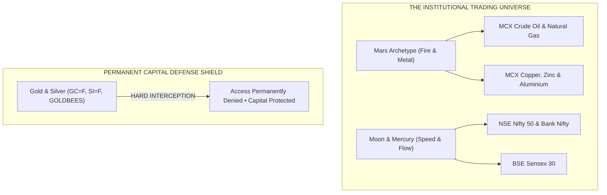

# CHAPTER 05: THE DAILY INDIAN MARKET RHYTHM
## The 12:22 PM Lunchtime Bell and The 3-Step Reversal Confirmation Rule

### 1. The Core Objective
To master the daily temporal heartbeat of the Indian market session (09:15 to 15:30 IST), understanding why 12:22 PM marks the primary intraday turning pivot and how to safely execute the 3-Step Yellow Traffic Light Rule.

---

> ### 🧠 The Master's Analogy: The School Lunchtime Bell
> Recall your days in primary school. 
> 
> * **The Morning Session (09:15 to 12:22)**: The school gates open at 09:15 AM. Children rush into classrooms full of restless morning energy. Everyone is writing, reciting, and working. But by noon, stomachs are growling, pens are dropping, and the morning stamina has completely run out.
> * **The 12:22 Bell (The Midpoint)**: The big brass bell in the schoolyard rings loud and clear: *Clang! Clang! Clang!* Everything stops. Books slam shut. Morning study is over; lunchtime has arrived.
> * **The Afternoon Session (12:22 to 15:30)**: After lunch, the energy flips. Children run onto the playground with fresh stamina for afternoon games. The morning rhythm is replaced by a completely new game.
> 
> The Indian stock market operates on the exact same human biological rhythm. The National Stock Exchange (NSE) opens at 09:15 AM. By **12:22 PM**, the morning opening momentum has exhausted its fuel. The 12:22 PM bell rings (True Solar Noon in Mumbai), marking the exact 50% midpoint of the day. The morning trend dies, and the afternoon trend is born.

---

### 2. The Astrodynamic & Geometric Principle
In Chapter 1, we saw how the fast Moon ticks across the sky. In Chapter 3, we proved that celestial angles dictate price lengths on your screen. Now observe how **Time divides into equal geometric halves**:

1. **The 375-Minute Session**: The NSE equity session begins at 09:15:00 IST and concludes at 15:30:00 IST. The total uninterrupted duration is exactly **375 minutes** ($6.25\text{ hours}$).
2. **The 180° Session Midpoint**: In circular geometry, half of $360^\circ$ is $180^\circ$. Half of 375 minutes is **187.5 minutes** ($3\text{ hours, } 7\text{ minutes, } 30\text{ seconds}$).
   $$\text{Session Start}: 09:15:00\text{ IST} + 03:07:30 = \mathbf{12:22:30\text{ IST}}$$
3. **The Spencer Equation of Time Alignment**: Because the exchange matching engines are geographically physically anchored in **Mumbai ($72.8777^\circ\text{ E}$)**, the astronomical transit of the Sun directly across the Mumbai meridian (True Solar Noon) prints between **12:12 PM and 12:44 PM IST**, clustering directly around 12:22 PM in early November.
4. **The Price-Time Mirror**: At 12:22 PM, Time reaches its 50% temporal midpoint ($180^\circ$). When market price simultaneously touches its **50% Daily Equilibrium line**, time and price mirror each other with extraordinary mathematical symmetry.

---

### 3. Visual Schematic: The Indian Intraday Session Arc

```mermaid
flowchart LR
    subgraph MorningClimb ["Morning Expansion (09:15 to 12:22 IST)"]
        OP["09:15 NSE Open"] -->|Initial Impulse Surge| M1["10:30 European Pre-Market"]
        M1 -->|Morning Trend Climax| NOON["12:22:30 IST Session Midpoint"]
    end

    subgraph AfternoonResolution ["Afternoon Resolution (12:22 to 15:30 IST)"]
        NOON -->|True Solar Noon Pivot| EU["13:00 European Open Volatility"]
        EU -->|Gann 90° Square Node (13:56)| CL["15:30 NSE Closing Bell"]
    end
```
*Figure 5.1: The 375-Minute Session Arc and the 12:22:30 IST Midpoint Reversal Pivot.*

---

### 4. Mathematical Definition of Session Circle Progress

The exact percentage of the trading day elapsed and its corresponding circular degree $\theta_{\text{session}}$ are calculated continuously from the opening bell:

$$T_{\text{elapsed}} = t_{\text{current}} - t_{\text{open}}$$

$$\text{Session Progress \%} = \min\left(100.0, \frac{T_{\text{elapsed}}}{T_{\text{total}}} \cdot 100\right)$$

$$\theta_{\text{session}} = \left( \frac{T_{\text{elapsed}}}{T_{\text{total}}} \right) \cdot 360.0^\circ$$

> **Variable Isolation Ledger**:
> - $\theta_{\text{session}}$ : **Session Wheel Angle** — The circular degree coordinate ($0.0^\circ \le \theta < 360.0^\circ$) displayed on the terminal.
> - $T_{\text{elapsed}}$ : **Elapsed Session Seconds** — Measured in continuous seconds from 09:15:00 IST.
> - $T_{\text{total}}$ : **Total Session Duration** — Exactly $22,500\text{ seconds}$ ($375\text{ minutes} \times 60$) for NSE; $53,700\text{ seconds}$ for MCX.
> - $12:22:30\text{ IST}$ : **The 180° Halfway Pivot** — Where $\theta_{\text{session}} = 180.0^\circ$ and $\text{Progress} = 50.0\%$.

---

> ### 🧠 The Master's Analogy: The Yellow Traffic Light
> When the terminal clock strikes 12:22 PM and an alert chimes, a beginner trader's first instinct is to smash the Buy or Sell button. 
> 
> *Never do this.* 
> 
> The chime is not a Green Light to enter blindly. **It is a Yellow Traffic Light.** It tells you: *"Tap your brakes. Slow down your car. Look left and right at the intersection."* 
> 
> You do not drive full speed through a yellow light; you prepare to stop and only proceed when you clearly see the road is open.

---

> 🖥️ **Live Terminal Connection**:  
> Look at the top row of the **`[Master Control Deck]`**. Find the second card labeled **`[Session Wheel Progress]`** and the third card labeled **`[True Solar Noon (Mumbai)]`**. 
> 
> Notice the progress percentage ticking steadily: `48.2%`, `49.1%`, `50.0%`. When that card reaches `50.0%` (`180.0°`), listen for the audio chime. Look at the fourth card labeled **`[50% Equilibrium Pivot]`**. If the active market price is resting right on that equilibrium number, the market has hit both 50% Time and 50% Price simultaneously.

---

### 5. Actionable Trading Rule: The 3-Step Reversal Confirmation Rule
When an alert chimes or the 12:22 PM Lunchtime Bell strikes, execute this non-negotiable 3-step checklist:

1. **Step 1: Notice the Time (The Yellow Light)**: Look at the clock. Verify that a valid time node has arrived ($12:22\text{ PM}$ Solar Noon or $13:56\text{ PM}$ Square Node). Take your hands off the mouse for 60 seconds to calm your pulse.
2. **Step 2: Check the Gann Price Level**: Look at the **`[Gann Harmonic Price Table]`**. Is the market price touching or within $\pm 0.15\%$ of a Cardinal Cross support line or the 50% Equilibrium line? If price is floating in the middle of nowhere with no Gann level nearby, **no trade exists**.
3. **Step 3: Wait 3 Minutes for a Confirming Candle**: Do not guess the turning tick. Look at your 1-minute or 3-minute candlestick chart. Wait for a clear reversal candle to close (a hammer, a shooting star, or a strong bullish/bearish engulfing bar). Only enter *after* the confirming candle closes, with your stop-loss placed 5 points behind the candle's wick.

---
---

# CHAPTER 06: CAPITAL DEFENSE & INSTRUMENTS
## Why Mars Rules Energy & Metals, and Why Gold & Silver Are Locked Out

### 1. The Core Objective
To understand which celestial bodies govern specific Indian exchange instruments, and to master the supreme capital defense rule: why Gold and Silver are permanently blacklisted from this terminal to protect retail capital.

---

> ⚠️ ### Institutional Risk Mandate: The High-Tide Capital Rule
> A beginner opening this terminal will immediately scan the menu and ask:  
> *"Where are Gold and Silver? Why can't I trade MCX Gold Petal or Silver Mini on this software?"*
> 
> The answer is brutal, honest, and designed to save your financial life:
> 
> **Gold and Silver are sovereign monetary instruments, not regular industrial goods.** They are the playground of global central banks, sovereign wealth funds, and multi-billion-dollar bullion cartels. 
> 
> A standard MCX Gold or Silver contract carries enormous tick leverage. When a sovereign bank unloads a bullion position, gold can drop ₹2,000 in fifteen seconds. A retail trader with a ₹1,00,000 account will be wiped out, liquidated, and deep in debt before their broker app can even refresh the quote.
> 
> *We do not fight heavyweight boxing champions in a back alley.* This terminal permanently locks out all gold and silver to defend your capital, forcing you to trade the high-reliability industrial growth of India where mathematical harmonics work cleanly and safely.

---

### 2. The Astrodynamic & Geometric Principle
In classical astrodynamics, every physical substance on Earth shares a vibrational resonance with a specific planetary archetype. 

In our terminal's **`[Sub-Control Strip]`**, instruments are strictly categorized into two clean, institutional universes:

#### 1. MCX Energy & Base Metals (Ruled by Mars $\mars$)
- **The Core Archetype**: Mars is the red planet of heat, combustion, engine pressure, and metallurgy.
- **Assigned Instruments**: 
  - **MCX Crude Oil (`CL=F`)**: Chemical energy and fuel pressure.
  - **MCX Natural Gas (`NG=F`)**: Thermal expansion and volatile gas pressure.
  - **MCX Copper (`HG=F`)**: The master electrical and industrial metal.
  - **MCX Zinc, Aluminium, Lead**: Structural manufacturing base metals.
- **The Empirical Rule**: When Mars forms a $90^\circ$ Square aspect with Jupiter or crosses into a new zodiac sign ($30^\circ$ Ingress), MCX Crude Oil and Copper reliably produce clean, explosive $60\text{ to }120\text{ point}$ swing legs.

#### 2. NSE Broad Indices (Ruled by Moon $\mathbb{M}$ & Mercury $\$$)
- **The Core Archetype**: The Moon controls fluid emotional tides; Mercury controls high-frequency communication, banking ledgers, and fast-breaking news.
- **Assigned Instruments**:
  - **NSE Nifty 50 (`^NSEI`)**: The 50 largest corporate engines of India.
  - **BSE Sensex (`^BSESN`)**: The premier barometer of Indian industrial capital.
  - **NSE Bank Nifty (`^NSEBANK`)**: Financial credit liquidity and interest rate sentiment.
- **The Empirical Rule**: As the fast Moon swings through its $45^\circ, 90^\circ,$ and $180^\circ$ aspects during the morning session, Nifty and Sensex print sharp, clean $50\text{ to }150\text{ point}$ intraday reaction waves.

---

### 3. Visual Schematic: The Instrument Allocation Matrix


*Figure 6.1: The Institutional Instrument Rulership Architecture and Bullion Defense Shield.*

---

### 4. Mathematical Comparison of Tick Risk Exposure

To understand why bullion destroys retail accounts, examine the physical **Value at Risk (VaR)** per standard $1.5\%$ adverse excursion between Nifty and MCX Silver:

$$\text{Adverse Rupee Risk} = \text{Contract Size} \times \left( \text{CMP} \cdot 0.015 \right)$$

> **Variable Isolation Ledger**:
> - $\text{Adverse Rupee Risk}$ : **Capital Drawdown (₹)** — Cash lost during a sudden $1.5\%$ intraday spike.
> - $\text{Contract Size}$ : **Exchange Lot Multiplier** — (25 shares for Nifty; 30 kg for standard MCX Silver).
> - $\text{CMP}$ : **Current Market Price** — Base trading price in Indian Rupees.
> - $0.015$ : **Standard 1.5% Volatility Factor** — The typical range of a news-driven intraday excursion.

#### The Risk Proof:
1. **NSE Nifty 50 (Lot Size = 25, CMP = 24,500)**:
   $$\text{Risk}_{\text{Nifty}} = 25 \times (24,500 \cdot 0.015) = 25 \times 367.5 = \mathbf{₹9,187.50}$$
   *(A manageable $3\%$ to $9\%$ drawdown on a standard active trading account).*
2. **MCX Silver Standard (Lot Size = 30 kg, CMP = ₹95,000 / kg)**:
   $$\text{Risk}_{\text{Silver}} = 30 \times (95,000 \cdot 0.015) = 30 \times 1,425 = \mathbf{₹42,750.00}$$
   *(A catastrophic $42\%$ account wipeout in a single 15-minute flash candle).*

---

> 🖥️ **Live Terminal Connection**:  
> Click the **`[Script Selector]`** dropdown menu on the **`[Sub-Control Strip]`**. Look at the active list: `NIFTY_50`, `SENSEX`, `BANK_NIFTY`, `CRUDE_OIL`, `NATURAL_GAS`, `COPPER`, `ALUMINIUM`, `ZINC`. 
> 
> Now, click the **`[+ Custom Script]`** button. In the dialog box, try typing `GOLD` or `SILVER` and press Register. 
> 
> Look at the screen: the terminal will flash an immediate red banner in the **`[Alert Ledger]`**:  
> `HARD REJECTION: Gold and Silver (bullion) instruments are strictly forbidden.`  
> The software’s built-in code defends your pocket even if you try to make an emotional mistake.

---

### 5. Actionable Trading Rule: The Universe Selection Protocol
1. **Trade Equities When the Moon is Fast**: On days when the Moon makes multiple aspects with Mercury or the Sun during market hours, focus your screen on **Nifty 50** and **Bank Nifty**.
2. **Trade Commodities When Mars is Active**: On days when Mars enters a new sign ($30^\circ$) or crosses a $90^\circ$ square with Jupiter, switch your screen to **MCX Crude Oil** or **MCX Copper**.
3. **Respect the Defense Shield**: Never attempt to bypass the bullion barrier by trading unauthorized synthetic gold proxies. Stick to the industrial instruments where mathematical wave mechanics produce consistent, survivable trading edges.
