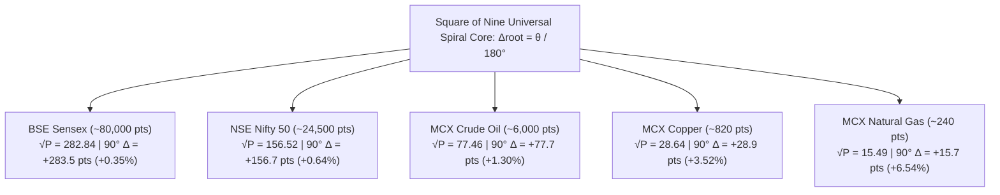

# CHAPTER 09: SQUARE OF NINE MATHEMATICAL SCALE INVARIANCE
## The Universal Odd-Square Root Formula across Five Indian Benchmark Markets

### 1. The Core Objective
To master the quantitative mechanics of W.D. Gann's Square of Nine odd-square spiral equation, proving that the exact same mathematical law governs a ₹240 commodity as precisely as an 80,000-point equity index.

---

> ### 🧠 The Master's Analogy: The Spiral Snail Shell & The Tape Measure
> Imagine unrolling a tailor's flexible cloth tape measure marked with numbers: $1, 2, 3 \dots 100 \dots 1,000 \dots 80,000$.
> 
> * **The Straight Line**: If you leave the tape stretched out flat along the floor, it looks like a never-ending, straight line of random prices.
> * **The Spiral Snail Shell**: Now, roll the tape around a center pin in an expanding spiral, like the shell of a snail. Every time you wrap the tape around one complete $360^\circ$ circle, the numbers stack directly on top of each other along four radial spokes: North ($90^\circ$), South ($270^\circ$), East ($0^\circ$), and West ($180^\circ$).
> 
> *The magic of the spiral is that big numbers and small numbers share the exact same directional spoke.* 
> 
> In Chapter 3, we proved that celestial angles in the sky act like the Sun dictating the length of your shadow on the ground. The Square of Nine formula is the **mathematical tape-measure** that translates that sky angle into the exact rupee price on your chart.

---

### 2. The Astrodynamic & Geometric Principle
In classical geometry, numbers arranged in a square spiral expand outward from a central unit ($1$) by concentric shells. The odd numbers squared ($1, 9, 25, 49, 81, 121 \dots$) anchor the fundamental corner axis of the matrix:
$$1^2 = 1, \quad 3^2 = 9, \quad 5^2 = 25, \quad 7^2 = 49, \quad 9^2 = 81$$

Notice the square roots of these cornerstone numbers:
$$\sqrt{1} = 1, \quad \sqrt{9} = 3, \quad \sqrt{25} = 5, \quad \sqrt{49} = 7, \quad \sqrt{81} = 9$$

Each complete $360^\circ$ ring rotation adds exactly **$+2.0$ to the square root** of the price:
- A $360^\circ$ full rotation adds $+2.0000$ to $\sqrt{P}$.
- A $180^\circ$ half rotation adds $+1.0000$ to $\sqrt{P}$.
- A $90^\circ$ quarter rotation (Cardinal Cross) adds $+0.5000$ to $\sqrt{P}$.
- A $45^\circ$ eighth rotation (Fixed Cross) adds $+0.2500$ to $\sqrt{P}$.

Because this formula operates on the square root of the price rather than linear rupees, it is **scale-invariant**. It automatically compresses percentage volatility for large numbers (Sensex) while expanding percentage volatility for small numbers (Natural Gas).

---

### 3. Visual Schematic: The Five-Asset Scale Invariance Matrix


*Figure 9.1: Universal Scale Invariance of Square of Nine 90° Harmonic Root Displacements Across Five Asset Orders of Magnitude.*

---

### 4. Mathematical Formulation & Five Benchmark Market Proofs

The universal bidirectional transformation equations between price $P$ and ecliptic angle $\theta$ are codified as:

$$\Delta\text{root} = \frac{\theta - \theta_0}{180^\circ}$$

$$P_{\text{target}} = \left( \sqrt{P_{\text{base}}} + \Delta\text{root} \right)^2$$

$$\theta_{\text{price}} = \left( \left( \sqrt{P} - 1.0 \right) \bmod 2.0 \right) \cdot 180^\circ$$

> **Variable Isolation Ledger**:
> - $P_{\text{target}}$ : **Harmonic Target Price Shelf** — The resultant price coordinate where time and space harmonize.
> - $P_{\text{base}}$ : **Base Anchor Price** — The swing low, swing high, or current market price (CMP).
> - $\Delta\text{root}$ : **Root Displacement Factor** — Dimensionless root shift ($+0.5000$ for $90^\circ$; $+0.2500$ for $45^\circ$).
> - $\theta$ : **Planetary Longitude** — Active ecliptic coordinate in degrees ($0.0^\circ \le \theta < 360.0^\circ$).
> - $\theta_{\text{price}}$ : **Wheel Needle Angle** — The circular degree position ($0^\circ \text{ to } 360^\circ$) of the asset's current price.

---

#### Institutional Proof Across All 5 Benchmark Assets ($90^\circ$ Cardinal Resistance Shelf):

```
┌────────────────────────────────────────────────────────────────────────────────────────┐
│ ASSET 1: BSE Sensex Index (Mega Equity Index: CMP = 80,000.00 pts)                    │
├────────────────────────────────────────────────────────────────────────────────────────┤
│ 1. Square Root Extraction : √80000 = 282.8427                                          │
│ 2. Apply 90° Cardinal Shift: 282.8427 + 0.5000 = 283.3427                             │
│ 3. Square Resultant Root  : (283.3427)² = 80,283.08 pts                                │
│ 4. Quantitative Interval  : +283.08 pts (+0.354% harmonic reaction zone)               │
└────────────────────────────────────────────────────────────────────────────────────────┘

┌────────────────────────────────────────────────────────────────────────────────────────┐
│ ASSET 2: NSE Nifty 50 Index (Broad Benchmark: CMP = 24,500.00 pts)                     │
├────────────────────────────────────────────────────────────────────────────────────────┤
│ 1. Square Root Extraction : √24500 = 156.5247                                          │
│ 2. Apply 90° Cardinal Shift: 156.5247 + 0.5000 = 157.0247                             │
│ 3. Square Resultant Root  : (157.0247)² = 24,656.78 pts                                │
│ 4. Quantitative Interval  : +156.78 pts (+0.640% harmonic reaction zone)               │
└────────────────────────────────────────────────────────────────────────────────────────┘

┌────────────────────────────────────────────────────────────────────────────────────────┐
│ ASSET 3: MCX Crude Oil Futures (Energy Heavyweight: CMP = 6,000.00 pts)                │
├────────────────────────────────────────────────────────────────────────────────────────┤
│ 1. Square Root Extraction : √6000 = 77.4596                                            │
│ 2. Apply 90° Cardinal Shift: 77.4596 + 0.5000 = 77.9596                               │
│ 3. Square Resultant Root  : (77.9596)² = 6,077.71 pts                                  │
│ 4. Quantitative Interval  : +77.71 pts (+1.295% harmonic reaction zone)                │
└────────────────────────────────────────────────────────────────────────────────────────┘

┌────────────────────────────────────────────────────────────────────────────────────────┐
│ ASSET 4: MCX Copper Futures (Base Metal Benchmark: CMP = 820.00 pts)                   │
├────────────────────────────────────────────────────────────────────────────────────────┤
│ 1. Square Root Extraction : √820 = 28.6356                                             │
│ 2. Apply 90° Cardinal Shift: 28.6356 + 0.5000 = 29.1356                               │
│ 3. Square Resultant Root  : (29.1356)² = 848.88 pts                                    │
│ 4. Quantitative Interval  : +28.88 pts (+3.522% harmonic reaction zone)                │
└────────────────────────────────────────────────────────────────────────────────────────┘

┌────────────────────────────────────────────────────────────────────────────────────────┐
│ ASSET 5: MCX Natural Gas Futures (Fast Low-Price Commodity: CMP = 240.00 pts)          │
├────────────────────────────────────────────────────────────────────────────────────────┤
│ 1. Square Root Extraction : √240 = 15.4919                                             │
│ 2. Apply 90° Cardinal Shift: 15.4919 + 0.5000 = 15.9919                               │
│ 3. Square Resultant Root  : (15.9919)² = 255.74 pts                                    │
│ 4. Quantitative Interval  : +15.74 pts (+6.558% harmonic reaction zone)                │
└────────────────────────────────────────────────────────────────────────────────────────┘
```

Notice the mathematical elegance: as the asset price decreases from 80,000 to 240, the absolute point interval naturally contracts ($+283.08 \rightarrow +156.78 \rightarrow +77.71 \rightarrow +28.88 \rightarrow +15.74$), while the percentage range automatically expands ($0.35\% \rightarrow 6.56\%$). The Square of Nine naturally respects the physical volatility of every asset class without human intervention.

---

> 🔬 ### First-Principles Physics: Hexagonal vs. Square Molecular Symmetry
> While the Square of Nine (Base 4) governs institutional banking credit and equities, Gann recognized a second geometric calculator: **The Hexagon Chart (Base 6)**.
> 
> * **The Square (Base 4: $90^\circ, 180^\circ, 270^\circ$)**: Built on the four seasons and right angles. Governs solid, physical, contractual assets: **BSE Sensex, NSE Nifty 50, and Banking Equities**.
> * **The Hexagon (Base 6: $60^\circ, 120^\circ, 180^\circ$)**: Built on equilateral triangles, close-packing spheres, the honeycomb, and the benzene ring. Governs hydrocarbons, fluid dynamics, and thermal heat: **MCX Crude Oil and Natural Gas**.
> 
> Energy commodity traders will notice that Crude Oil frequently reverses with supreme violence at **$60^\circ$ and $120^\circ$ Trine angles**, because fluid hydrocarbons vibrate naturally to hexagonal molecular symmetry.

---

> 🖥️ **Live Terminal Connection**:  
> In the **`[Master Control Deck]`**, look at the **`[Gann Harmonic Price Table]`**. Toggle through different active instruments in the **`[Script Selector]`**: switch from `NIFTY_50` to `CRUDE_OIL`, then to `NATURAL_GAS`. 
> 
> Notice how the table instantly recalculates all support and resistance lines around CMP. Check the `Distance` column: on Nifty it displays distances of $\approx 78\text{ to }156\text{ pts}$; on Natural Gas it displays distances of $\approx 7\text{ to }15\text{ pts}$. You are watching the scale-invariance formula executing live.

---

### 5. Actionable Trading Rule: The Scale-Invariance Execution Protocol
1. **Never Adjust the Formula for Price Size**: Use the exact $+0.5000$ root constant whether you are trading Sensex at 80,000 or Natural Gas at 240. Never attempt to artificially stretch or compress the math.
2. **Anchor from Clean Swing Pivots**: Always take your $P_{\text{base}}$ from the day's confirmed opening tick or the major session low/high.
3. **Target the Opposite Spoke**: When price breaks through a $+0.5000$ Cardinal shelf on expanding volume, your primary target is the subsequent $+0.5000$ Cardinal shelf ($180^\circ$ opposite spoke).

---
---

# CHAPTER 10: THE SOLAR NOON SEASONAL DRIFT
## The Spencer Equation of Time, Earth's Elliptical Orbit, and Mumbai Meridian Transits

### 1. The Core Objective
To understand why True Solar Noon in Mumbai drifts between 12:12 PM and 12:44 PM IST across the calendar year, and how to calibrate your trading desk to Nature's true solar clock rather than man's artificial wristwatch.

---

> ### 🧠 The Master's Analogy: The School Sundial vs. The Wristwatch
> Imagine standing in the school courtyard next to an ancient bronze sundial while looking at your digital wristwatch:
> 
> * **Man's Artificial Wristwatch (Standard IST)**: Your wristwatch is rigid, mechanical, and stubborn. It ticks at an unbending speed of exactly 60 seconds every minute, 365 days a year. It pretends that the Sun moves at a completely robotic, constant speed across the sky every single day.
> * **Nature's Sundial (True Solar Time)**: The bronze sundial doesn't care about man's mechanical watch. It listens to the real Sun. In January and February, the sundial's shadow lags behind your watch by up to 14 minutes. In October and November, the sundial's shadow sprints ahead of your watch by up to 16 minutes!
> 
> Ask yourself: *Does human biological stamina and market liquidity respond to an artificial battery in a watch, or to the real Sun shining through the office windows?*
> 
> In Chapter 5, we introduced the 12:22 PM Lunchtime Bell as the 50% midpoint of the NSE session. Now, as an intermediate quant, you learn that **Nature drifts that bell between 12:12 PM and 12:44 PM** as the seasons turn.

---

### 2. The Astrodynamic & Geometric Principle
The apparent motion of the Sun across the sky is non-uniform due to two fundamental astronomical realities:

1. **Earth's Elliptical Orbit (Kepler's Second Law)**: Earth does not orbit the Sun in a circle; it travels in an ellipse with an eccentricity of $e \approx 0.0167$. In January (perihelion), Earth is closest to the Sun and moves faster along its orbital track ($\approx 30.29\text{ km/s}$). In July (aphelion), Earth is farthest and travels slower ($\approx 29.29\text{ km/s}$).
2. **The Obliquity of the Ecliptic ($23.44^\circ$ Tilt)**: Earth's rotational axis is tilted by $23^\circ 26'$ relative to its orbital plane. The Sun's apparent path travels along the tilted Ecliptic, not along the flat celestial equator. When projected onto the equator, the Sun's eastward progress speeds up at the solstices and slows down at the equinoxes.

The mathematical difference between **Apparent Solar Time** (sundial) and **Mean Solar Time** (clock) is defined as the **Equation of Time ($\text{EoT}$)**.

---

### 3. Visual Schematic: The Spencer Equation of Time Curve

```
EoT (Minutes)
 +20 |                                           * (Late Oct: +16.3 min)
 +15 |                                          / \
 +10 |                 * (May: +3.8 min)       /   \
  +5 |                / \                     /     \
   0 - - - - - - - - / - - - - - - - - - - - / - - - \ - - - - - - - - - - - - (Clock = Sun)
  -5 |              /     \                 /         \
 -10 |             /       \               /           \
 -15 |            /         * (July: -6.4)             \
 -20 |  * (Mid-Feb: -14.2 min)                          * (Dec 25: 0 min)
     +------------------------------------------------------------------------> Day of Year
       Jan   Feb   Mar   Apr   May   Jun   Jul   Aug   Sep   Oct   Nov   Dec
```
*Figure 10.1: The Annual Spencer Equation of Time Oscillation Curve Across the 365-Day Cycle.*

---

### 4. Mathematical Definition of True Solar Noon at Mumbai

The astronomical Equation of Time is calculated using the rigorous **Spencer Fourier Series (1971)**:

$$\Gamma = \frac{2\pi \cdot (N - 1)}{365}$$

$$\text{EoT} = 229.18 \cdot \Big( 0.000075 + 0.001868\cos\Gamma - 0.032077\sin\Gamma - 0.014615\cos(2\Gamma) - 0.040849\sin(2\Gamma) \Big)$$

$$\text{True Solar Noon (IST)} = 12:00:00 - \frac{\text{EoT}}{60} + \left( \frac{\lambda_{\text{standard}} - \lambda_{\text{Mumbai}}}{15^\circ} \right)$$

> **Variable Isolation Ledger**:
> - $\text{EoT}$ : **Spencer Equation of Time** — The seasonal correction factor measured in decimal minutes.
> - $N$ : **Day of the Year** — Integer day index ($1 \le N \le 365$, where Jan $1 = 1$).
> - $\Gamma$ : **Fractional Day Angle** — Measured in radians.
> - $\lambda_{\text{standard}}$ : **Indian Standard Time Meridian** — Fixed at $82.5000^\circ\text{ E}$ (Mirzapur reference axis, UTC+05:30).
> - $\lambda_{\text{Mumbai}}$ : **Mumbai Exchange Server Meridian** — High-precision coordinates of the NSE/BSE hub ($72.8777^\circ\text{ E}$).
> - $15^\circ$ : **The Hourly Earth Rotation Constant** — ($360^\circ / 24\text{ hours} = 15^\circ/\text{hour} = 4\text{ minutes/degree}$).

#### The Longitudinal Offset of the Mumbai Exchange:
$$\Delta t_{\text{longitude}} = \frac{82.5000^\circ - 72.8777^\circ}{15^\circ} = \frac{9.6223^\circ}{15^\circ} = +0.64149\text{ hours} = \mathbf{+38.49\text{ minutes}}$$

Because Mumbai sits **$9.62^\circ$ West** of the Indian standard time meridian, the Sun arrives in Mumbai exactly **$38.49\text{ minutes}$ later** than at the standard Mirzapur clock tower!

#### The Annual Solar Transit Extremes at Mumbai:
- **Mid-February ($N=45$, $\text{EoT} \approx -14.2\text{ min}$)**:
  $$\text{Solar Noon} = 12:00:00 - (-14.2/60) + 0:38:29 = 12:00:00 + 0:14:12 + 0:38:29 = \mathbf{12:52:41\text{ IST}}$$
- **Late October / Early November ($N=309$, $\text{EoT} \approx +16.3\text{ min}$)**:
  $$\text{Solar Noon} = 12:00:00 - (16.3/60) + 0:38:29 = 12:00:00 - 0:16:18 + 0:38:29 = \mathbf{12:22:12\text{ IST}}$$

---

> 🖥️ **Live Terminal Connection**:  
> In the **`[Master Control Deck]`**, look at the third card on the top row labeled **`[True Solar Noon (Mumbai)]`**. Notice that it displays the exact time: `12:22:12 IST`. 
> 
> Now, go to the **`[Sub-Control Strip]`**, enter `12:22` into the **`[Custom Time Inspector]`** box, and click **`[Inspect]`**. The entire terminal recalculates all planetary coordinates to that precise solar second. You are aligning your analysis with the exact moment the physical Sun crosses the zenith over the exchange servers.

---

### 5. Actionable Trading Rule: The Solar Drift Trading Protocol
1. **Never Use a Rigid 12:00 PM Clock**: Forget 12:00 PM. In India, the market's solar zenith never occurs at 12:00 PM; it always occurs between 12:12 PM and 12:52 PM depending on the month.
2. **Check the Solar Card at 09:00 AM**: Record the exact minute displayed on the `[True Solar Noon]` card. Set an alarm on your desk for that specific minute.
3. **Execute the Midpoint Reversal Setup**: When the solar transit minute arrives, check if Nifty is trading near a Cardinal Cross line. If price shows rejection wicks at that exact minute, enter the reversal trade with absolute conviction.
